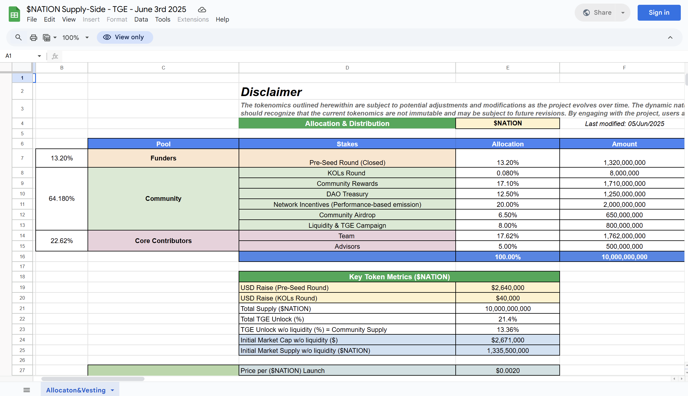
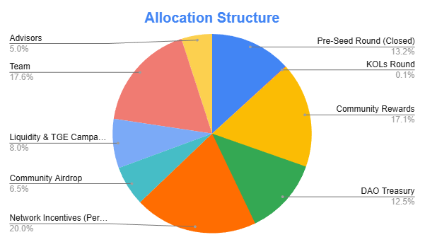
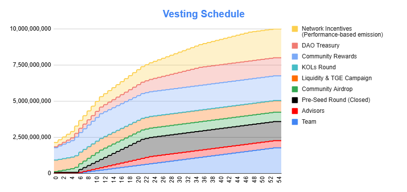

This is the official [$NATION token supply-side and vesting dashboard](https://docs.google.com/spreadsheets/d/1OGwGvVclsqIruX5rF9y12YGy9eKlSvtS-3xRc3dyO40/edit?gid=1960278588#gid=1960278588). It outlines our allocation structure, unlock schedules, inflation dynamics, and control evaluation across stakeholders. The sheet also includes visualizations to help track supply flow, community vs company control, and token ownership over time. It’s designed to ensure full transparency for our community, partners, and investors.

## Supply Information Sheet

[$NATION Token Supply-side and Vesting Dashboard](https://docs.google.com/spreadsheets/d/1OGwGvVclsqIruX5rF9y12YGy9eKlSvtS-3xRc3dyO40/edit?gid=1960278588#gid=1960278588)

## Allocation Structure

## Vesting Schedule

